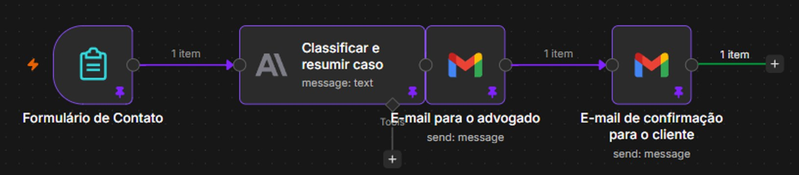

# Triagem jurídica com IA (n8n)

Automação feita no [n8n](https://n8n.io) para um escritório de advocacia. O cliente conta o caso num formulário, a IA (Claude, da Anthropic) identifica a área do direito e resume o relato, e o advogado recebe tudo organizado por e-mail. O cliente recebe na hora uma confirmação de que o caso chegou.



## Como funciona

1. **Formulário de Contato** (Form Trigger): o cliente preenche nome completo, WhatsApp, e-mail e o relato do caso.
2. **Classificar e resumir caso** (Anthropic / Claude): classifica o caso em exatamente uma área (Criminal, Previdenciário ou Juizado Especial Cível) e escreve um resumo de 3 linhas, num formato fixo:
   ```
   ÁREA: <área>
   RESUMO:
   <linha 1>
   <linha 2>
   <linha 3>
   ```
3. **E-mail para o advogado** (Gmail): envia os dados do cliente, a classificação, o resumo e o relato original.
4. **E-mail de confirmação para o cliente** (Gmail): avisa que o caso foi recebido e encaminhado.

## Exemplo real de teste

Relato enviado no formulário:

> Trabalhei 32 anos com carteira assinada e dei entrada na aposentadoria no INSS há 8 meses. Até hoje não tive resposta e não sei o que fazer.

Resposta da IA no e-mail do advogado:

```
ÁREA: Previdenciário
RESUMO:
O cliente trabalhou por 32 anos com carteira assinada e requereu aposentadoria ao INSS há 8 meses.
Até o momento não houve nenhuma resposta ou decisão do INSS sobre o pedido, o que indica demora excessiva na análise.
O cliente busca orientação sobre como proceder, sendo possível avaliar medidas como a verificação do andamento do processo e eventual ação judicial para obrigar o INSS a decidir.
```

## Como usar este fluxo

1. No n8n, crie um fluxo novo e use **Import** para importar o arquivo [`workflow.json`](workflow.json).
2. Conecte as credenciais:
   - **Anthropic** no bloco "Classificar e resumir caso" (chave de API da Anthropic ou os créditos de IA do n8n Cloud).
   - **Gmail** nos dois blocos de e-mail.
3. No bloco "E-mail para o advogado", troque `advogado@exemplo.com.br` pelo e-mail que vai receber os casos.
4. Teste com **Execute** e, quando estiver tudo certo, clique em **Publish** para ativar o formulário.

## Aprendizados

- **Erro real corrigido:** o modelo mais novo do Claude não aceita mais o parâmetro `temperature`, e o bloco falhava com `Bad request: temperature is deprecated for this model`. A solução foi remover a opção Temperature do bloco.
- **Testes sem incomodar o cliente:** durante os testes, o e-mail do advogado foi apontado para o meu próprio e-mail.
- **Privacidade:** a versão publicada aqui não contém credenciais, identificadores internos do n8n nem dados de clientes.

## Ferramentas

n8n · Claude (Anthropic) · Gmail · Formulários

---

Feito por [Matheus Paulino](https://badolfr22-dot.github.io).
